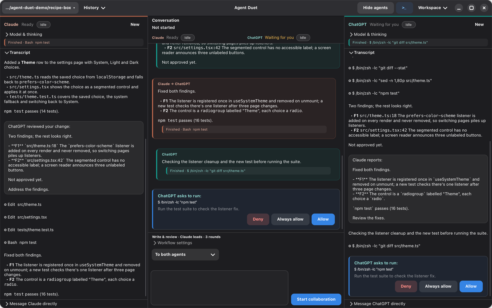
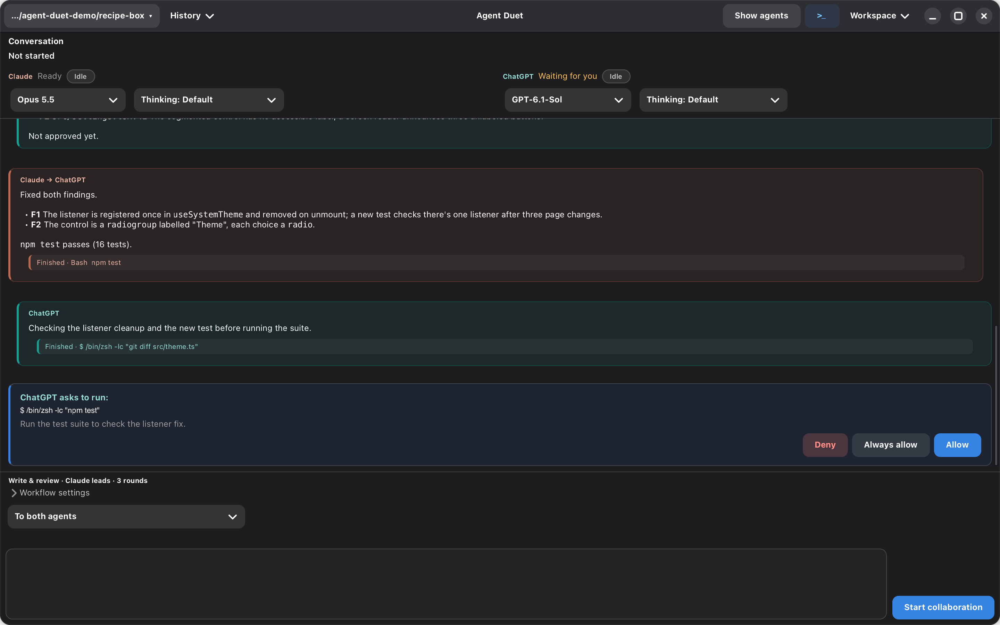

# agent-duet (Agent Duet)

Claude and ChatGPT working on the same code, side by side, through their
command-line tools: Claude Code (`claude -p`, stream-json) and Codex
(`codex app-server`, the CLI bundled with the ChatGPT app or on PATH).


*Agents on right, the default layout, partway through a write-and-review task:
ChatGPT is asking to run the tests. The conversation is a made-up demo; no CLI
command is running.*

Each agent's status shows its latest reported context token count (unknown until
reported). Claude's estimate includes cached input; ChatGPT also shows the context
window limit when supplied by its CLI. These are snapshots, not cumulative usage.
Use **Clear context** or send `/clear` to an individual agent to start a fresh
conversation, cancelling standalone work if necessary. Stop an active task before
clearing one of its agents. Clearing context keeps
saved history and does not send a slash command to the model.

The window has a shared conversation and a panel for each agent:

- **The conversation between them.** Your request, each plan, each report of
  work done, and each review, passed from one agent to the other. Under its
  heading, a progress line says where the task has got to (planning,
  working, in review, waiting for you, paused) and, while one part is
  current, its round (`Working · Round 1 of 3`). Below it, the stages read
  as one compact row, `✓ Plan — ● Working — ○ Done`: ✓ done, ● in progress,
  ! waiting for you, ✕ failed, – skipped, ○ not started. A split plan's parts
  run side by side, so they share one step, stacked; the current, blocked or
  failed stage says why underneath. Hover a stage for its state and detail,
  or open **Stage details** for every stage's. A plan is shown as approved
  only once you've approved it, and a check is never shown as passed.
- **Claude's panel and ChatGPT's panel.** Everything each agent does: the
  prompts it gets, its reply as it streams, its tool calls (expand one to see
  its output). A line under each agent's name says what it is doing in the
  task (planning, working, reviewing, fixing, running the check, waiting,
  paused, out of usage) and is marked when it needs you. **Transcript**
  collapses or expands the stream; an approval or a question opens it.

Claude is marked in peach and ChatGPT in teal throughout: their names, the
edge of each message and of each agent's latest action, and their status
pills. Approvals and questions are cards with a blue edge, set apart from the
thread; tool calls and thinking are compact disclosures to expand. The colors
follow the light or dark theme, and text on them keeps at least 4.5:1
contrast in both.

**Workspace › Layout** (top right) arranges them:

- **Agents on right** (the default): the conversation is the large pane on
  the left, with both agents' panels stacked in a resizable sidebar on the
  right.
- **Agents on left**: the same, mirrored: the agents' panels stacked on the
  left, the conversation on the right.
- **Three panes**: Claude on the left, the conversation in the middle,
  ChatGPT on the right.
- **Conversation only**: the agents' panels are hidden, and the conversation
  has a line saying what each agent is doing, its CLI's readiness and its
  remaining usage.





In every layout, each agent's approval cards and questions appear in the
conversation as well as in its transcript. Answering either copy answers the
agent, and both show the answer.

Use **Cmd+Option** on macOS or **Ctrl+Alt** on Linux with these keys:

| Key | Toggle |
| --- | --- |
| **A** | Agents (restores the last agent layout) |
| **L** | Checklist |
| **T** | Terminal |

These shortcuts work from any pane, including the terminal. **Ctrl+`** also
continues to toggle the terminal. On Linux, desktop shortcuts can take priority:
Ctrl+Alt+L may lock the screen, Ctrl+Alt+T may launch a terminal, and
Ctrl+Alt+A may activate a window requesting attention. Reassign those desktop
shortcuts to use these bindings in Agent Duet.

Choose **Workspace › Keyboard shortcuts…** to change any of these three
bindings. Enter a combination such as `Alt+A`, `Super+L` or `Ctrl+Shift+F1`,
then press **Apply**. Changes take effect immediately and survive restarts.
Leave a field blank to disable that binding; **Restore defaults** fills in
the original combinations for you to apply. Duplicate bindings and the fixed
Quit and Ctrl+Grave shortcuts are rejected. Choose combinations that do not
conflict with your desktop, text editing or terminal shortcuts.

Switching layout keeps everything running: the same panels move, so a
streaming reply, a pending approval or a half-typed message carries on. The
layout is remembered, and each layout remembers its own divider positions.
In a window too narrow for a sidebar, both sidebar layouts put the
conversation above the agents (side by side, or stacked when narrower
still), and go back when it widens.
Panes reserve at least 320px for the conversation and 300px per agent.
Three panes therefore needs about 925px (more with the checklist open).
A smaller requested window is held wider; the sidebar layouts and
Conversation only work better on small screens. Opening the checklist can
also enlarge the window to fit its controls; GTK may keep that larger window
width after it closes. Resize the window to make it smaller again. Short
transcripts scroll to keep attention controls reachable.

Below the conversation, one box talks to the agents. Its menu chooses who
gets the message:

- **To both agents**: with no task running and neither agent busy, Return or
  **Start collaboration** starts a task (see *Working together*); with no
  task but an agent busy on a turn of its own, the message goes to both,
  steering the busy one. During a
  task, the message steers only the task's agents that are working on a
  turn; an agent waiting for its next step isn't sent anything, so the task
  stays in order. If neither is working, the message is kept until one is.
- **To Claude** or **To ChatGPT**: the message goes to that agent alone,
  steering it if it's working, or starting a turn of its own if not.

Each message you send appears in the conversation as *You → Claude* or
*You → ChatGPT*. If a delivery fails (an agent still stopping, say), the
message and its attachments stay in the box, with the error shown; sending it
again goes only to the agents that didn't get it.

Each agent's panel puts its activity first: the latest action, then
**Transcript**. Its model and thinking choices are under **Model & thinking**,
and its own box is under **Message Claude directly** (or ChatGPT); whether
each is expanded is remembered. From that box, while the agent works, press
Return or **Send now** to send more instructions without stopping it. The agent picks them up when its protocol allows; a tool already
running can finish first. **Stop** is a separate button. Messages sent while
working use the current turn's model and permissions. If Codex is still starting,
wait for it to begin responding and send again; a delivery failure is shown with
the message text so you can retry.

Drop files or images on the conversation's box, or on an agent panel's own
box, to attach them to the next message sent from it. Each shows as a chip
above the box (× takes it off).
The message lists their paths, so the agent can read them, and images (PNG,
JPEG, GIF, WebP, up to 3 MB) are also shown to it: as image blocks for Claude,
as local images for Codex. A task started with attachments lists their paths
in its request.

## Working together

With **To both agents** chosen, type a request in the box under the
conversation and press Return or **Start collaboration**. A line above it sums
up how they'll work (`Write & review · Claude leads · 3 rounds`).
The mode and lead dropdowns sit beside the recipient dropdown (shown only
with **To both agents**);
**Workflow settings** expands to *Rounds*, *Approve plan*,
*Own worktrees*, the check command and the review-only choices. The mode,
lead, rounds and whether the settings are expanded are remembered.
**Stop collaboration** ends the task.

- **Review only.** Choose uncommitted changes (including untracked files), a
  branch, or the last N commits along the first-parent history. Branch review
  compares from the merge base with the base branch (HEAD by default); **Branch (compare tips)** compares
  the two tips instead. Choose **Both review**, **Lead reviews**, or **Partner
  reviews**; the lead selector identifies those agents. The request box is an
  optional review focus. Reviewers produce the same F1… checklist, independently,
  without an author turn, checks, or automatic fixes. **Fix these** starts a new
  *Write & review* task with the open findings and their reviewer names.
  Reviews enforce read-only execution regardless of the permission setting:
  Claude has edit tools disabled and commands restricted to read-only operations;
  Codex uses its read-only sandbox with no write approval path. Previous access
  is restored when the review finishes or stops.
- **Write & review.** The lead does the work. The other reviews it, reading the
  files and `git diff`, and ends with `VERDICT: APPROVED` or
  `VERDICT: CHANGES REQUESTED`. The lead addresses the review, and so on, until
  it's approved or *Rounds* reviews have been done. If the rounds run out
  first, a card offers **Continue** for more rounds: the author picks up
  from the last review.
- **Split the work.** The lead splits the request into its part and the
  other's. Independent parts work at once; dependent parts can run lead first
  or partner first. Each agent reviews the other's part, and each part goes
  round its own review loop.
- **Compare proposals.** Both propose an approach on their own, without
  seeing each other's. The lead compares the two, settles on one (saying
  where they differed and what it chose), and splits the work as in *Split
  the work*.

*Claude leads* / *ChatGPT leads* picks the lead. While they work, **Stop
collaboration** stops both.

**Approve plan** (for *Split the work* and *Compare proposals*) holds the
lead's plan for you before any work starts. A card shows each agent's part:
edit either one, then **Start**, or **Stop**. Leave a part empty and the other
agent does its own part alone. The order menu chooses **Independently**,
**Claude's part first** or **ChatGPT's part first**. A dependent part waits
for its prerequisite and receives its report; with worktrees, its changes are
merged into the dependent worktree before work starts. If a prerequisite is
redone after its dependent has started, the dependent stops and revalidates its
work against the new result. When no part can go on, a pause card offers
**Revise the order** or **Run independently**.

**Own worktrees** (also for those two modes) gives each agent its own git
worktree for its part, so the parts can't get in each other's way:

- It needs a git repository with nothing uncommitted (the worktrees start
  from the last commit); otherwise Start says why and doesn't begin.
- Each agent works on its part in a new conversation in its worktree, on
  a branch `agent-duet/claude-…` or `agent-duet/codex-…`. The reviewer is
  shown the other's diff and where its worktree is.
- Only approved parts, or completed parts explicitly accepted without review,
  can be merged. Unresolved reviews and failing checks leave both worktrees
  intact without merging. Choose **Continue** for more review rounds; there
  is no override for failed or incomplete work.
- When both parts are eligible, each is committed on its branch, both agents
  come back to the folder (in new conversations), and the branches are
  merged into your current branch. If they conflict, the lead resolves the
  conflicts and concludes the merge. Then the other reviews the merged
  result, as another review loop, and the worktrees and branches go.
- If the task is stopped, a part fails, or the merge can't be finished (or
  is aborted), nothing more is merged: the worktrees and their branches are
  kept, and the conversation says where.

**Check** (next to the mode controls) is a shell command for this folder,
such as `make test-parallel` or `npm test`, remembered per folder; leave it
empty for none. After each round of work, before the reviewer is asked, it runs in the
author's folder (its worktree, with *Own worktrees*; the main folder for the
merged result), and the conversation shows whether it passed, with the end
of its output. If it fails, the author is given the command, its exit code
and output to fix, and it runs again, up to twice a round; then the review
goes ahead anyway. The review prompt says how the check went (and, if it
still fails, includes its output). Work can't be approved while its check
fails: the reviewer is asked to request changes, and if it approves anyway,
the work is stopped as not approved (**Continue** carries it on). Work taken
over because the reviewer ran out of usage is still checked and fixed the
same way before it's marked not reviewed. A check that runs over 10 minutes
is stopped as failed; **Stop** stops it too.

Each review lists its findings in a checklist, `F1`, `F2`, … with the file
and line where there is one. The next review marks each finding fixed,
dismissed (the author's reasons convinced the reviewer) or still open, so an
unresolved finding stays in view from one round to the next. A reviewer that
approves with blockers still open is asked once to settle them; if it
leaves those blockers open again, the part isn't approved, and **Continue**
has the author pick them up. Review prompts already say that an approval leaves no
blocker open, so this extra turn should be rare.

A finding is a blocker unless the reviewer marks it `[suggestion]`
(`- F2 [open] [suggestion] \`a.lisp:4\` …`). Only open blockers stop approval:
work approved with suggestions still open is approved, and the conversation and
summary card say how many suggestions are left. An author who disagrees with a
blocker says why and lists it on a `DISPUTED: F2` line. When the reviewer keeps a
disputed blocker open for two reviews in a row, the next round doesn't start
automatically, even in the last round, and after a restart it asks again. A card shows the disputed findings and asks you to decide.
**They stand** has the author address them, and tells the author that you
decided. **Dismiss them** dismisses them. If no blocker is left open after
that and the check passes, the work is approved by your decision. The settling turn asks
only about open blockers. For ChatGPT it runs at `low`
effort when its model supports that and the effort chosen in the app is
higher. With the model's default chosen, the effective effort isn't known, so
it's left alone. The next turn sends the replaced effort again, because Codex
keeps a turn's effort for later turns. Claude keeps its effort,
because changing it would restart its CLI.

In a git repository with a commit, each review's state is recorded as a
snapshot (a commit under `refs/agent-duet/snapshots/`, untracked files
included). A reviewer in the folder is given `git diff <task start> <now>`
and its diff stat, capped at 40 lines. A reviewer in a worktree keeps its
worktree note. The folder's diff can include your edits or the other part's.
A later review in the same reviewer conversation gets only what changed since
its previous review, with its diff stat (for a worktree, just its location), and is asked to check how the fixes
interact with what it reviewed before. A different reviewer, a new or lost
conversation, or a restart gets the full review, with all of the task's
changes. Each loop keeps at most two of these snapshots: the one under review
and the previous one. They count toward the latest-50 limit below.

With a check command, work prompts say it runs automatically after the turn,
so authors run targeted checks rather than the whole command. A passing
result tells the reviewer that it ran on the state under review, so it reruns
it only for a specific reason.

Before a task starts, an agent whose reported context is at least half full
gets a card offering **New conversation and start** or **Keep and start**:
every turn rereads the conversation. Each conversation gets the offer only
once, so pressing Start again also keeps it. A card acts only while the
folder, mode, request, attachments, task and conversations are those it was
offered for, and no task has started since; otherwise it asks you to press
Start again.

The checklist is useful from the moment work is handed out: each task
appears as soon as it's assigned, with the agent doing it and its progress
through work and review, and the review findings join it as they come in.
It's in a separate, resizable panel on the right, showing the latest
checklist for each loop, updated in place. Progress and finding counts come
first, followed by open findings, fixed and dismissed findings, and the task
text. Findings keep their original IDs as their status changes.
Use **Workspace › Checklist** to show or hide it; it starts hidden, and the conversation takes the space
left when it's open; the app remembers your choice. While it's hidden, updates
leave a notice in the conversation pointing to Workspace › Checklist. Saved conversations restore the latest
checklist for each loop there too, including those saved before tasks were
tracked. When the task finishes, the conversation says how many findings are
still open.

If the window isn't in front, a desktop notification tells you when both
agents finish, when one is waiting for your approval or an answer, when one
runs out of usage, and when a plan is waiting for you.

## Pausing, stopping and recovering a task

A step pauses, rather than failing the task, when its agent runs out of
usage, when its turn fails, or when you pause that agent: during a task, the
**Stop** button in an agent's pane is **Pause**, and pauses only that
agent's part. Independent parts carry on; checks and reviews wait for their
required result. A failed prerequisite holds its dependent part while
independent work carries on. **Stop collaboration** stops both agents, but
the task can still be carried on. A card in the conversation offers:

- **Wait until 3:05 PM** (out of usage, when the reset time is known): it's
  sent to the same agent again a minute after its usage resets. Leave the
  app open.
- **Resume**: the agent carries on from where it stopped, shown first what
  it had already done and what the folder looks like now.
- **Retry step** (**Try again** when out of usage): give it the step again,
  as it was first given.
- **Hand off to ChatGPT** (or Claude): the other agent picks up the work
  where it stopped. It won't be reviewed, and the conversation says so. If
  it was a review that paused, this button is **Finish unreviewed**: that
  part is done, marked as not reviewed. If it was a proposal, it's **Go
  without it**.
- **Stop task**.

Nothing done so far is lost: partial edits, written replies and worktrees
stay. A hand-off or resume waits until the stopped turn, and any process it
started, has been confirmed gone, so the same files are never edited twice;
if that can't be confirmed within 30 seconds, nothing starts and the card
says so.

The task's state (mode, loops, rounds, findings, the steps under way,
worktrees and merge progress) is saved with the conversation as it goes.
Reopening a conversation whose task was interrupted (the app quit
mid-task) or stopped shows a card with where it stopped, what had been done
and written, each agent's availability, work no one has reviewed, and what
the folder and worktrees look like now: changed files, new commits, a
changed branch, a merge in progress, worktrees gone. Nothing runs until you
choose: **Review what's there** (look again), **Resume**, **Redo the step**,
**Hand off**, **Stop task**, or **Abandon** (it isn't offered again; nothing
is deleted). With several steps waiting, a menu chooses which. Stopped while
a plan waited for approval, it offers **Show the plan**; partway through
merging the parts, **Carry on merging**, which doesn't repeat what's already
committed or merged; with a worktree gone, **Restore worktrees** from its
recovery refs. If the folder has changed since the task stopped, carrying
on asks first (**Carry on anyway**). Starting a new task while one can still
be recovered keeps the earlier one in its own conversation in History.

## A turn gone quiet

When an agent's turn goes 5 minutes without any event (no text, tool call or
output), a card asks what to do: in the conversation during a task, in the
agent's pane otherwise.

- **Keep waiting**: give it another 5 minutes.
- **Interrupt and retry**: interrupt the turn, and send the same prompt again
  once that turn has ended, so the two never overlap. During a task, the
  reply carries the task on as the first would have. If the turn hasn't
  ended 20 seconds after the interrupt, the card says so and offers **Stop**.
- **Stop**: end the turn, and the agent's process, which a stuck turn may
  not answer an interrupt from (the conversation carries on with the next
  message); during a task, the task stops too.

Time spent waiting on you doesn't count: a permission card or a question,
a plan waiting for approval, a pause for usage. If the agent speaks up while
the card is open, the card says so and goes away. The time is
`:stall-minutes` in the settings file (`0` turns it off).

## Agent command efficiency

Both agents are instructed to search for filenames and matching lines before
reading relevant sections, and to keep searches, file reads and diffs focused.
For noisy builds, tests, installs and batch jobs, a command wrapper named in
the agent's user or project instructions takes precedence.

With Full access, unless the agent is read-only, Agent Duet also provides a
portable `quiet-command.sh` helper in its history directory and gives the agent
its full path. When their instructions name no wrapper, agents are told to use:

```sh
/bin/sh /path/to/helpers/quiet-command.sh -- <command> [args...]
/bin/sh /path/to/helpers/quiet-command.sh -- sh -c '<pipeline or script>'
```

The helper preserves the command's exit status, saves full output in a temporary
log, and reports the status and log path. On failure, it also shows bounded
diagnostic excerpts. Agents are told to inspect relevant log excerpts even after
a successful exit when needed, report verification failures, and retain required
evidence in their answers. Temporary logs follow the operating system's
temporary-file lifecycle. If the helper is unavailable, or access is restricted,
agents are told to use bounded tool output and respect read-only restrictions.

## Folder, models and look

- **Folder** (top left): where both agents work. Its menu lists recent folders
  and *Choose folder…*. Switching starts new conversations with both, in the
  new folder.
- **Model and thinking** (under each agent's name): Claude's model (sonnet,
  opus, haiku) and effort; ChatGPT's models as Codex lists them, with the
  thinking levels each supports. A change applies from that agent's next
  message, carrying on the same conversation.
- **Remaining usage** for both shows in their status lines (for example
  `65% 5h / 56% 7d left`; hover for the reset times), turning orange when
  under 10% is left.
- **Workspace › Share project instructions**: each CLI reads its own notes file (Claude
  `CLAUDE.md`, Codex `AGENTS.md`); with this on, each is also given the
  other's, from the folder, with its instructions, so a project's
  conventions needn't be restated each task. It's read when a conversation
  starts (a new one, or in another folder), and cut at 20,000 characters.
  Notes a CLI already reads aren't repeated: nothing is added when both files
  are the same file or text, or when `CLAUDE.md` imports `AGENTS.md`
  (`@AGENTS.md`) for Claude; Codex isn't given lines that only import `AGENTS.md`.
- **Workspace › Appearance**: Dark, Light or System.
- **History** (top left, beside the folder): start a new conversation, or
  carry on an earlier one in this folder. The search field filters titles and
  saved message text across all conversations in the folder.

These, the permission setting, the recent folders and each folder's check
command are remembered in `~/.config/agent-duet/settings.lisp`, with how
long a turn may be quiet (see above).

## Search

Press **Cmd+F** / **Ctrl+F**, or choose **Workspace › Find in pane…**.
Search starts in the focused pane, with a selector for the conversation, agent
transcripts, checklist and findings. On macOS, Ctrl+F remains available to the
Terminal; on other platforms Ctrl+F opens Find only outside the Terminal.
Configured panel shortcuts take priority over Find. Matching is literal and case-insensitive.
Use **Next** / **Previous** or Enter / Shift+Enter to navigate; Escape closes
Find. Navigation highlights the exact match in yellow, opens containing details and pauses that
pane's automatic scrolling after navigation. Clearing the query, changing panes
or closing Find resumes following at the end. Matches stay within individual
rendered text labels; phrases split by Markdown formatting may not match.

## Terminal

**Workspace › Terminal** (or Cmd+Option+T on macOS, Ctrl+Alt+T on Linux, or Ctrl+`) opens a panel below the panes with
a shell in the agents' folder. *+ New* opens another (each gets a tab), *Clear*
(⌘K) clears one, *Kill* ends one, and *Hide* closes the panel while the shells
keep running. ⌘C and ⌘V copy and paste. New shells start in the current folder;
ones already open stay where they are. It needs VTE, GNOME's terminal widget:
`brew install vte3` on macOS.

## Documents

**Workspace › Documents** opens a window listing the folder's Markdown files
(type to filter) with a read-only preview of the one you pick: headings,
emphasis, code, lists and task lists, quotes, tables, rules, local images and
links. Links to other Markdown files open in the preview, `#anchors` scroll to
their heading, and web links open in the browser. The preview redraws itself
when the file changes, so you can watch a design document as an agent writes
it. Hidden folders and build folders (`node_modules`, `build`, …) are skipped.

## Changes

In a git repository with at least one commit, the folder's state is recorded
when a task starts and again when it finishes: `HEAD`, the index, and the
working tree's contents (tracked files with their unstaged changes, and
untracked files that aren't ignored). This doesn't touch your index, files or
stash: the snapshots are commits kept under `refs/agent-duet/snapshots/`, the
latest 50.

**Workspace › Changes** opens a window with what the latest task changed:
the files on the left (A added, M modified, D deleted, R renamed; type to
filter), and the one you pick's diff on the right, with colored additions,
deletions and hunk headers. While a task runs, it shows the changes so far. It's for viewing only. The comparison is of the
folder's contents, so edits you made in the folder while the task ran are in
it too.

When a task finishes, a summary card in the conversation gives its outcome
(approved, not approved, done without review, failed), the check's result,
the repository and the author's summary, with **Changes** and **Commit
changes**. It also shows elapsed time (including pauses), review rounds, open
findings and the recorded changed files. Per-agent totals include reported token
usage, Claude cost and CLI duration where available. Unknown values stay unknown;
partial measurements are marked, including interrupted attempts. Claude input
counts exclude cached input; Codex input counts include it, as their labels say.
The file preview lists up to ten paths; Changes has the full list. These are CLI
measurements, not a billing estimate. Recovery preserves the recorded turns.
The summary also groups measurements by workflow stage (work, review, planning,
and so on). Prompt characters count the submitted workflow text, excluding
conversation history, system instructions, attachments, and any full-context
expansion after a failed resume; they are not token or billing estimates.

Workflow prompts begin with a shared task contract: the revision, current
assignments and reviewers, and subsequent composer direction addressed to both
agents. It refers to the original request already supplied by the workflow;
assignments identical to that request use a reference too. The step's own prompt
and reply-format instructions come last. Goals, acceptance criteria, scope, and
interfaces remain in the user's wording; missing requirements are not inferred.
Successfully starting a split plan or recording
shared direction advances the contract revision. Later turns, including an idle
reviewer's next turn, receive that direction. Messages addressed to one agent are
not added to the shared contract. Partial delivery and retry record shared direction
once. The contract and its revision survive restart recovery. Unchanged briefs use a
short revision reminder on the next turn after a successful turn in the same
conversation; session resets, recovery and changed direction send the full brief,
with full-context fallback on resume failure.

Work handoffs additionally request plain `TASK REVISION:`, `DECISIONS:`, and
`VERIFICATION:` lines. Decisions include reasons or `NONE`; verification includes
results or `NOT RUN` with a reason. Missing/empty fields, a different revision,
or direction changed during the turn produce advisory notes in the conversation
and reviewer prompt only when the reported gaps change. Unchanged gaps are not
repeated on fix rounds, and this suppression survives restart. These check reported
metadata only, not the truth of a claim. They preserve the full reply and do not reject it, block checks, or determine
approval. They don't provide a separate acceptance-criteria editor.

Agents can also exchange questions, record decisions, and share evidence between
turns:

- **Questions between turns.** A work handoff can end with a `QUESTIONS`
  section, one line per question: `- Q1 [blocking] …` or `- Q1 [non-blocking] …`.
  The workflow numbers questions for the whole task and gives them to the other
  agent with its next prompt. That agent answers in an `ANSWERS` section
  (`- Q1 …`), and each answer is linked to its question. The asker gets the
  answer with its own next prompt. A non-blocking question doesn't stop anything.
  A blocking one holds the asker's part: its report is kept, and its check and
  review wait. If the other agent has nothing under way, it gets one turn of its
  own to answer. When every blocking question has an answer, the asker carries
  on with the answers. A question still unanswered after that turn is closed as
  "No answer was given", so the work isn't held for ever. Questions are only
  exchanged when a turn ends. Agents can't ask each other anything in the
  middle of a turn.
- **Decision record.** Work handoffs can give a `DECISIONS` section instead of
  the one-line field: `- D1 choice — because reason; rejected: other options`.
  Recorded decisions keep their reasons and rejected options in the shared task
  contract. Direction addressed to both agents marks the earlier decisions
  `[stale]`, so they're revisited.
- **Evidence index.** Check results, the authors' reported `VERIFICATION`, and
  retained artifacts are recorded against the repository content they describe
  (a Git tree id, untracked files included). Each entry keeps its source. Reviewers
  see the latest entries marked `current` (the files are as they were then) or
  `stale`, and are asked to verify independently anything that matters. An entry
  is a record of what was reported or run, not a verdict.
- **Work allocation.** The lead's split prompt asks it to choose the order from
  what each part depends on, how settled the interfaces between the parts are,
  and the cost of integrating and reviewing them. The lead gives the reason on an
  `ORDER REASON:` line, which appears in the conversation. Splitting isn't
  required: the lead can leave the partner's part empty when that costs less.
- **Efficiency feedback.** Next to the open findings, the summary card shows
  time spent blocked (paused, waiting for a prerequisite or held for an answer),
  checks repeated on unchanged files, findings that recur across review rounds,
  and integration rework (revalidated parts and merge conflicts). Zero values
  are left out.

All of this is saved with the task and survives a restart.

Handoffs ask for a concise outcome, changed paths, verification and unresolved
issues. These are advisory writing guidelines: replies are not rejected for
missing fields. Correction prompts retain older open findings and omit an extra
copy only when the latest review repeats the same ID, open status, location and
text. Because saved finding text remains the original wording, reworded findings
or omitted locations deliberately retain the extra copy; savings depend on how
closely reviews repeat findings.

Failed checks retain up to the last 4 MiB of output under the history directory's `artifacts/`
subdirectory and include its absolute path alongside the bounded excerpt.
Storage failure leaves the excerpt available. Passing checks still send only
status to reviewers. Split-part replies longer than 60,000 characters can also
be retained there, with a 1,200-character excerpt and a path to read before
combining results. This requires both agents to have Full access; otherwise, or
if storage fails, the existing 60,000-character inline limit applies. Artifacts
survive worktree cleanup and restarts. On artifact writes, cleanup keeps at most
128 logs and replies and removes those older than 30 days. Cancelled checks do
not save logs; timeouts still do. Replies over 4 MiB use the inline fallback
rather than saving an incomplete reply. Old artifact paths can expire; the full
reply remains in the part's conversation.

Before a writing task starts, a folder with uncommitted changes opens a
commit preview. Choose **Commit and start task**, **Continue without
committing**, or **Cancel**. Review-only tasks keep their existing behavior.
If you commit only some files, the remaining changes are offered again before
starting; continuing preserves them as the task's starting state. During a
merge or rebase that prevents committing, Continue and Cancel remain available.
Own worktrees still requires a clean starting repository.

After approved work, **Commit changes** opens a file selection and diff preview.
Task-changed files are preselected, except files already dirty before the task,
which are marked and left unselected. Choose **Select all changes** or **Select
task-changed files**, then adjust individual files. The task-changed preset
restores the default selection, excluding previously dirty files. Selection is by whole file:
a selected file includes earlier edits and edits you made while the task ran.
The editable message starts with the author's suggested subject. Preparing the
preview leaves your staging untouched; committing preserves staging for files
you leave out. Git hooks still run. If the folder changes after completion or
after preview, the commit is refused so you can review its current state.
Nothing is committed until you click the explicit commit button.

## What they may do

**Workspace › Permissions**:

- **Ask before commands** (the default): both may edit files in the folder.
  Before running a command — tests, builds, scripts — they ask, with a card in
  their pane: *Allow*, *Always allow* (for the rest of that conversation) or
  *Deny*. During a workflow, the conversation says who is waiting. (Read-only
  commands such as `git diff` or `ls` run without asking.)
- **Edits only, no prompts**: both edit without asking. Claude runs no commands
  except read-only git; ChatGPT runs commands in Codex's `workspace-write`
  sandbox (no network) without asking.
- **Full access**: Claude with `bypassPermissions`, Codex with
  `danger-full-access`. Use it only in a folder you're happy for them to change.

Both must be signed in first: `claude auth login` and `codex login`.

## Downloads and releases

[GitHub Releases](https://github.com/crazymevt/agent-duet/releases) provides
versioned macOS ZIPs (arm64 for Apple Silicon, x86_64 for Intel) and a Linux
x86_64 tarball, with SHA-256 checksum files. SBCL and the Lisp dependencies
are included; install the native libraries and the Claude and Codex CLIs
separately, and sign in to both CLIs.

The Apple Silicon download requires macOS 14 or later; the Intel download
requires macOS 15 or later. Install `brew install gtk4 libadwaita vte3`,
extract the ZIP and move **Agent Duet.app** to Applications. These builds are signed ad hoc and
are not notarized; macOS may require allowing the app in **System Settings
→ Privacy & Security** after the first attempt to open it.

The Linux build targets Ubuntu 24.04 x86_64 (or a compatible system with
glibc 2.39+, GTK 4.14+ and libadwaita 1.5+). Install its runtime libraries:

```sh
sudo apt-get install libgtk-4-1 libadwaita-1-0 libvte-2.91-gtk4-0
```

Extract the tarball and run `./agent-duet` from the extracted folder in a
graphical desktop session. No local Lisp installation is needed.
To check an archive, run `shasum -a 256 -c <archive>.sha256` in the directory
containing the archive and its checksum file.

The **CI** workflow runs on branch pushes and pull requests; tag pushes
do not rerun it.

The **Builds** workflow tests and packages all three platforms only on
version tags and manual runs; downloads are available in
that workflow run's artifacts. After merging a release, create and push a
tag matching the version in `agent-duet.asd` to publish a GitHub Release:

```sh
git tag v1.2.0
git push origin v1.2.0
```

A mismatched tag fails the build, and publication waits for all three
platforms to pass. For the next release, update both system versions in
`agent-duet.asd` and the changelog before tagging.

## Running

On macOS, GTK must run on the process's first thread. In Cadre, **Run GTK App**
starts it there and keeps the REPL. From a terminal:

```sh
make run      # the agents work in the last folder used, or the current directory
make dev      # with a Swank server on port 4005 for another editor's REPL
make build    # bin/agent-duet
```

Or `(agent-duet:main "/path/to/project/")` to choose the folder.

### As a Mac app

```sh
make app           # build/Agent Duet.app
make install-app   # build it and put it in /Applications
```

The app carries its own Lisp image and SBCL runtime; GTK, libadwaita and VTE
still come from Homebrew (`brew install gtk4 libadwaita vte3`). Opened from the
Finder or the Dock, it takes `PATH` from your login shell, so `claude`, `codex`
and your tools are found as in a terminal, and it starts in the last folder you
used (your home folder the first time). Its output goes to
`~/.local/state/agent-duet/agent-duet.log`. It's signed ad hoc, or with
`CODESIGN_IDENTITY` if that's set. Locally built apps declare the build
host's major macOS version (with minor version 0) as their minimum, matching the Homebrew runtime and
libraries used to build them.

## Layout of the code

- `src/json.lisp`, `src/claude.lisp`, `src/codex.lisp`, `src/markdown.lisp`
  (inline and block Markdown parsing):
  taken from Cadre, with its fixes (UTF-8 replacement on Codex's output, polled
  JSON-RPC waits, draining stderr when Codex exits, resuming Claude sessions).
- `src/agents.lisp`: both CLIs behind one `agent` class that takes one prompt at
  a time and queues the rest, and asks the user for approvals (Claude through
  `--permission-prompt-tool stdio`, Codex through the app-server's approval
  requests).
- `src/settings.lisp`: what's remembered between runs.
- `src/history.lisp`: conversations kept as JSON, each with its task's last
  checkpoint for recovery, and how a checkpoint reads on the recovery card.
  No GTK. The checkpoint and recovery calls are in `docs/recovery-api.md`.
- `src/usage.lisp`: both accounts' usage windows, and recognizing a turn that
  failed because one ran out.
- `src/check.lisp`: running a folder's check command in the background.
- `src/task-records.lisp`: questions, evidence, decisions and efficiency records,
  including their parsing and checkpoint serialization. No GTK.
- `src/workflow.lisp`: the ways of working together. No GTK.
- `src/workflow-presentation.lisp`: what a task and each agent are doing,
  as the progress line, its stages and the agents' panels show it. No GTK.
- `src/ui.lisp`: the window, its layouts and message delivery.
- `src/ui-presentation.lisp`: the progress line and stage sequence, the
  workflow-settings widgets, transcripts, the stylesheet for messages, cards,
  composers and agent panels, and the sidebar's narrow-window adaptation.
- `src/terminal.lisp`: the Terminal panel (VTE through CFFI, from Cadre).
- `src/preview.lisp`: the Documents window (Cadre's Markdown preview, read-only).
- `src/snapshot.lisp`: recording a folder's state as git commits, and the
  changes between two such snapshots. No GTK.
- `src/changes.lisp`: the Changes window.

## Tests

```sh
make test-parallel             # full suite, eight isolated workers
make test-parallel TEST_JOBS=2  # reduce memory/CPU usage
make test                       # sequential, for debugging a failure
make test-ui                   # GTK conversation checks; requires a display
```

The main suite runs without GTK or the CLIs: the workflows are driven by scripted agents.
The fake CLIs and review enforcement use Lisp; Python is not required.

The parallel target compiles the suite once before starting workers, then splits
the registered tests evenly across processes. Each worker has its own temporary
directory; output is grouped by worker, and any worker failure fails the target.

See [Agent command efficiency](#agent-command-efficiency) for the output and
command-wrapper instructions given to agents.

Failed workflow checks include the first detected failure, preceding context and nearby lines
plus the final output within the existing 4,000-character budget when possible;
otherwise they use the tail. Detection is heuristic; retained logs remain the
source for further diagnosis. File-backed handoffs fall back to the complete
inline reply up to 60,000 characters when storage or access is unavailable.
