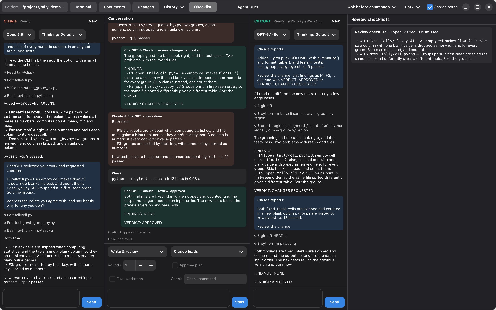

# agent-duet (Agent Duet)

Claude and ChatGPT working on the same code, side by side, through their
command-line tools: Claude Code (`claude -p`, stream-json) and Codex
(`codex app-server`, the CLI bundled with the ChatGPT app or on PATH).



The window has three panes:

- **Left: Claude.** Everything Claude does: the prompts it gets, its reply as it
  streams, its tool calls (expand one to see its output).
- **Middle: the conversation between them.** Your request, each plan, each
  report of work done, and each review, passed from one agent to the other.
- **Right: ChatGPT.** The same, for Codex.

**View** in the header switches to **Conversation only**: the side panes are
hidden, and the middle pane shows each agent's approval cards and questions
(answering one there answers that agent), with a line under its heading
saying what each is doing: working, reviewing, running the check, waiting for
the other or for you, paused. **All panes** brings the side panes back. The
choice is remembered.

Each side pane also has its own box for talking to that agent alone.
While it works, press Return or **Send now** to send more instructions without
stopping it. The agent picks them up when its protocol allows; a tool already
running can finish first. **Stop** is a separate button. Messages sent while
working use the current turn's model and permissions. If Codex is still starting,
wait for it to begin responding and send again; a delivery failure is shown with
the message text so you can retry.

Drop files or images on a side pane's message box to attach them to your next
message to that agent. Each shows as a chip above the box (× takes it off).
The message lists their paths, so the agent can read them, and images (PNG,
JPEG, GIF, WebP, up to 3 MB) are also shown to it: as image blocks for Claude,
as local images for Codex. Dropping files on the middle request box types
their paths into the request instead.

## Working together

Type a request in the middle and press Return. Choose how they work:

- **Write & review.** The lead does the work. The other reviews it, reading the
  files and `git diff`, and ends with `VERDICT: APPROVED` or
  `VERDICT: CHANGES REQUESTED`. The lead addresses the review, and so on, until
  it's approved or *Rounds* reviews have been done. If the rounds run out
  first, a card offers **Continue** for more rounds: the author picks up
  from the last review.
- **Split the work.** The lead splits the request into its part and the
  other's (parts that don't touch the same files). Both work at once; then each
  reviews the other's part, and each part goes round its own review loop.
- **Compare proposals.** Both propose an approach on their own, without
  seeing each other's. The lead compares the two, settles on one (saying
  where they differed and what it chose), and splits the work as in *Split
  the work*.

*Claude leads* / *ChatGPT leads* picks the lead. Start becomes Stop while they
work.

**Approve plan** (for *Split the work* and *Compare proposals*) holds the
lead's plan for you before any work starts. A card shows each agent's part:
edit either one, then **Start**, or **Stop**. Leave a part empty and the other
agent does its own part alone.

**Own worktrees** (also for those two modes) gives each agent its own git
worktree for its part, so the parts can't get in each other's way:

- It needs a git repository with nothing uncommitted (the worktrees start
  from the last commit); otherwise Start says why and doesn't begin.
- Each agent works on its part in a new conversation in its worktree, on
  a branch `agent-duet/claude-…` or `agent-duet/codex-…`. The reviewer is
  shown the other's diff and where its worktree is.
- When both parts are done, each is committed on its branch, both agents
  come back to the folder (in new conversations), and the branches are
  merged into your current branch. If they conflict, the lead resolves the
  conflicts and concludes the merge. Then the other reviews the merged
  result, as another review loop, and the worktrees and branches go.
- If the task is stopped, a part fails, or the merge can't be finished (or
  is aborted), nothing more is merged: the worktrees and their branches are
  kept, and the conversation says where.

**Check** (next to the mode controls) is a shell command for this folder,
such as `make test` or `npm test`, remembered per folder; leave it empty for
none. After each round of work, before the reviewer is asked, it runs in the
author's folder (its worktree, with *Own worktrees*; the main folder for the
merged result), and the conversation shows whether it passed, with the end
of its output. If it fails, the author is given the command, its exit code
and output to fix, and it runs again, up to twice a round; then the review
goes ahead anyway. The review prompt says how the check went (and, if it
still fails, includes its output). Work can't be approved while its check
fails: the reviewer is asked to request changes, and if it approves anyway,
the work is stopped as not approved (**Continue** carries it on). Work taken
over because the reviewer ran out of usage is still checked and fixed the
same way before it's marked not reviewed. A check that runs over 10 minutes
is stopped as failed; **Stop** stops it too.

Each review lists its findings in a checklist, `F1`, `F2`, … with the file
and line where there is one. The next review marks each finding fixed,
dismissed (the author's reasons convinced the reviewer) or still open, so an
unresolved finding stays in view from one round to the next. A reviewer that
approves with findings still open is asked once to settle them; if it
leaves them open again, the part isn't approved, and **Continue** has the
author pick them up.

The checklist is useful from the moment work is handed out: each task
appears as soon as it's assigned, with the agent doing it and its progress
through work and review, and the review findings join it as they come in.
It's in a separate, resizable panel on the right, showing the latest
checklist for each loop, updated in place. Use **Checklist** in the header
to show or hide it; the app remembers your choice. Hidden updates leave a
notice in the conversation. Saved conversations restore the latest
checklist for each loop there too, including those saved before tasks were
tracked. When the task finishes, the conversation says how many findings are
still open.

If the window isn't in front, a desktop notification tells you when both
agents finish, when one is waiting for your approval or an answer, when one
runs out of usage, and when a plan is waiting for you.

## Running out of usage

When an agent's account runs out partway through a task, its step pauses
instead of failing, and a card in the middle pane offers:

- **Wait until 3:05 PM** (when the reset time is known): it's sent to the
  same agent again a minute after its usage resets. Leave the app open.
- **Try again**: send it again now.
- **Let ChatGPT take over** (or Claude): the other agent picks up the work
  where it stopped. It won't be reviewed, since the reviewer is the one out,
  and the conversation says so. If it was a review that paused, this button is
  **Finish unreviewed**: that part is done, marked as not reviewed. If it was
  a proposal, it's **Go without it**: the lead plans from the other proposal,
  or, if the lead is the one out, the other carries out its own, unreviewed
  (after you approve that, with *Approve plan*).
- **Stop**.

Nothing done so far is lost. While an agent is out, with a known reset time,
it turns prompts away without trying; its status line says until when.

## A turn gone quiet

When an agent's turn goes 5 minutes without any event (no text, tool call or
output), a card asks what to do: in the middle pane during a task, in the
agent's pane otherwise.

- **Keep waiting**: give it another 5 minutes.
- **Interrupt and retry**: interrupt the turn, and send the same prompt again
  once that turn has ended, so the two never overlap. During a task, the
  reply carries the task on as the first would have. If the turn hasn't
  ended 20 seconds after the interrupt, the card says so and offers **Stop**.
- **Stop**: end the turn, and the agent's process, which a stuck turn may
  not answer an interrupt from (the conversation carries on with the next
  message); during a task, the task stops too.

Time spent waiting on you doesn't count: a permission card or a question,
a plan waiting for approval, a pause for usage. If the agent speaks up while
the card is open, the card says so and goes away. The time is
`:stall-minutes` in the settings file (`0` turns it off).

## Folder, models and look

- **Folder** (top left): where both agents work. Its menu lists recent folders
  and *Choose folder…*. Switching starts new conversations with both, in the
  new folder.
- **Model and thinking** (under each agent's name): Claude's model (sonnet,
  opus, haiku) and effort; ChatGPT's models as Codex lists them, with the
  thinking levels each supports. A change applies from that agent's next
  message, carrying on the same conversation.
- **Remaining usage** for both shows in their status lines (for example
  `65% 5h / 56% 7d left`; hover for the reset times), turning orange when
  under 10% is left.
- **Shared notes** (top right): each CLI reads its own notes file (Claude
  `CLAUDE.md`, Codex `AGENTS.md`); with this on, each is also given the
  other's, from the folder, with its instructions, so a project's
  conventions needn't be restated each task. It's read when a conversation
  starts (a new one, or in another folder), and cut at 20,000 characters.
- **Dark / Light / System** (top right).

These, the permission setting, the recent folders and each folder's check
command are remembered in `~/.config/agent-duet/settings.lisp`, with how
long a turn may be quiet (see above).

## Terminal

**Terminal** in the header (or Ctrl+`) opens a panel below the three panes with
a shell in the agents' folder. *+ New* opens another (each gets a tab), *Clear*
(⌘K) clears one, *Kill* ends one, and *Hide* closes the panel while the shells
keep running. ⌘C and ⌘V copy and paste. New shells start in the current folder;
ones already open stay where they are. It needs VTE, GNOME's terminal widget:
`brew install vte3` on macOS.

## Documents

**Documents** in the header opens a window listing the folder's Markdown files
(type to filter) with a read-only preview of the one you pick: headings,
emphasis, code, lists and task lists, quotes, tables, rules, local images and
links. Links to other Markdown files open in the preview, `#anchors` scroll to
their heading, and web links open in the browser. The preview redraws itself
when the file changes, so you can watch a design document as an agent writes
it. Hidden folders and build folders (`node_modules`, `build`, …) are skipped.

## Changes

In a git repository with at least one commit, the folder's state is recorded
when a task starts and again when it finishes: `HEAD`, the index, and the
working tree's contents (tracked files with their unstaged changes, and
untracked files that aren't ignored). This doesn't touch your index, files or
stash: the snapshots are commits kept under `refs/agent-duet/snapshots/`, the
latest 50.

**Changes** in the header opens a window with what the latest task changed:
the files on the left (A added, M modified, D deleted, R renamed; type to
filter), and the one you pick's diff on the right. While a task runs, it
shows the changes so far. It's for viewing only. The comparison is of the
folder's contents, so edits you made in the folder while the task ran are in
it too.

When a task finishes, a summary card in the conversation gives its outcome
(approved, not approved, done without review, failed), the check's result,
the repository and the author's summary, with **Changes** and **Commit
changes**. Nothing is committed until you click it, with the message in the
box beside it (the request's first line to start with). The button is only
enabled when the approved work's changes are still what's in the folder; when
it isn't, the card says why (there's nothing to commit, say). The card then
shows the commit, or why it failed.

## What they may do

The menu at the top right:

- **Ask before commands** (the default): both may edit files in the folder.
  Before running a command — tests, builds, scripts — they ask, with a card in
  their pane: *Allow*, *Always allow* (for the rest of that conversation) or
  *Deny*. During a workflow, the middle pane says who is waiting. (Read-only
  commands such as `git diff` or `ls` run without asking.)
- **Edits only, no prompts**: both edit without asking. Claude runs no commands
  except read-only git; ChatGPT runs commands in Codex's `workspace-write`
  sandbox (no network) without asking.
- **Full access**: Claude with `bypassPermissions`, Codex with
  `danger-full-access`. Use it only in a folder you're happy for them to change.

Both must be signed in first: `claude auth login` and `codex login`.

## Downloads and releases

[GitHub Releases](https://github.com/crazymevt/agent-duet/releases) provides
versioned macOS ZIPs (arm64 for Apple Silicon, x86_64 for Intel) and a Linux
x86_64 tarball, with SHA-256 checksum files. SBCL and the Lisp dependencies
are included; install the native libraries and the Claude and Codex CLIs
separately, and sign in to both CLIs.

The Apple Silicon download requires macOS 14 or later; the Intel download
requires macOS 15 or later. Install `brew install gtk4 libadwaita vte3`,
extract the ZIP and move **Agent Duet.app** to Applications. These builds are signed ad hoc and
are not notarized; macOS may require allowing the app in **System Settings
→ Privacy & Security** after the first attempt to open it.

The Linux build targets Ubuntu 24.04 x86_64 (or a compatible system with
glibc 2.39+, GTK 4.14+ and libadwaita 1.5+). Install its runtime libraries:

```sh
sudo apt-get install libgtk-4-1 libadwaita-1-0 libvte-2.91-gtk4-0
```

Extract the tarball and run `./agent-duet` from the extracted folder in a
graphical desktop session. No local Lisp installation is needed.
To check an archive, run `shasum -a 256 -c <archive>.sha256` in the directory
containing the archive and its checksum file.

The **CI** workflow runs on branch pushes and pull requests; tag pushes
do not rerun it.

The **Builds** workflow tests and packages all three platforms only on
version tags and manual runs; downloads are available in
that workflow run's artifacts. After merging a release, create and push a
tag matching the version in `agent-duet.asd` to publish a GitHub Release:

```sh
git tag v1.0.0
git push origin v1.0.0
```

A mismatched tag fails the build, and publication waits for all three
platforms to pass. For the next release, update both system versions in
`agent-duet.asd` and the changelog before tagging.

## Running

On macOS, GTK must run on the process's first thread. In Cadre, **Run GTK App**
starts it there and keeps the REPL. From a terminal:

```sh
make run      # the agents work in the last folder used, or the current directory
make dev      # with a Swank server on port 4005 for another editor's REPL
make build    # bin/agent-duet
```

Or `(agent-duet:main "/path/to/project/")` to choose the folder.

### As a Mac app

```sh
make app           # build/Agent Duet.app
make install-app   # build it and put it in /Applications
```

The app carries its own Lisp image and SBCL runtime; GTK, libadwaita and VTE
still come from Homebrew (`brew install gtk4 libadwaita vte3`). Opened from the
Finder or the Dock, it takes `PATH` from your login shell, so `claude`, `codex`
and your tools are found as in a terminal, and it starts in the last folder you
used (your home folder the first time). Its output goes to
`~/.local/state/agent-duet/agent-duet.log`. It's signed ad hoc, or with
`CODESIGN_IDENTITY` if that's set. Locally built apps declare the build
host's major macOS version (with minor version 0) as their minimum, matching the Homebrew runtime and
libraries used to build them.

## Layout of the code

- `src/json.lisp`, `src/claude.lisp`, `src/codex.lisp`, `src/markdown.lisp`
  (inline and block Markdown parsing):
  taken from Cadre, with its fixes (UTF-8 replacement on Codex's output, polled
  JSON-RPC waits, draining stderr when Codex exits, resuming Claude sessions).
- `src/agents.lisp`: both CLIs behind one `agent` class that takes one prompt at
  a time and queues the rest, and asks the user for approvals (Claude through
  `--permission-prompt-tool stdio`, Codex through the app-server's approval
  requests).
- `src/settings.lisp`: what's remembered between runs.
- `src/usage.lisp`: both accounts' usage windows, and recognizing a turn that
  failed because one ran out.
- `src/check.lisp`: running a folder's check command in the background.
- `src/workflow.lisp`: the ways of working together. No GTK.
- `src/ui.lisp`: the window.
- `src/terminal.lisp`: the Terminal panel (VTE through CFFI, from Cadre).
- `src/preview.lisp`: the Documents window (Cadre's Markdown preview, read-only).
- `src/snapshot.lisp`: recording a folder's state as git commits, and the
  changes between two such snapshots. No GTK.
- `src/changes.lisp`: the Changes window.

## Tests

```sh
make test
```

They run without GTK or the CLIs: the workflows are driven by scripted agents.
